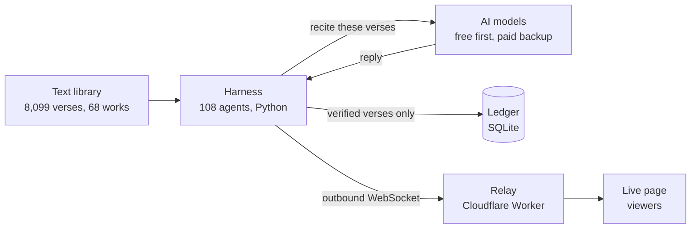

# Akhand 108

108 AI "pandit" agents that recite Hindu prayers around the clock for one person, with every verse checked against the book before it counts.
A public page shows it live: **https://akhand-108.tech-inkosei.workers.dev**


*Screenshot from a local test run (the numbers are test data).*

"Akhand" means unbroken. 108 is the number of beads on a mala.

## How it works



- **12 stations of 9 agents.** Each station has its own deity and texts: Shiv japa, Durga Saptashati, Ramcharitmanas, Hanuman Chalisa, Vishnu Sahasranama, Bhagavad Gita, the Navagraha and more. The full table is in [docs/spec.md](docs/spec.md).
- **The model recites with the book open.** The verse text is in the prompt, the model writes it out, and the harness compares the reply with the book exactly (after tidying spacing and punctuation). A wrong word does not count and the verse is recited again.
- **Nothing is counted twice or skipped.** Every verified verse is written to a small database before it is announced, so a crash or restart resumes from the same place.
- **Free models first.** Requests go to free models in order. A paid backup is used only when all of them are unavailable, inside a hard monthly and weekly dollar cap. When nothing is usable the agents rest, and the page says so.
- **Daily gathering.** At 06:00 all 108 stop, recite the sankalpa (the statement of who the prayer is for and why) and three opening prayers together, then return to their stations. The sankalpa can include that day's panchang (tithi, nakshatra, month and so on), worked out in [harness/akhand/panchang.py](harness/akhand/panchang.py).
- **Nothing on the page is simulated.** A bead lights only when its agent has a verse verified. The page has an optional synthesised sound.

## What is in here

| Folder | What |
| --- | --- |
| [harness/](harness/) | The prayer program (Python 3.12, asyncio, two dependencies). Details and edge cases: [harness/README.md](harness/README.md) |
| [relay/](relay/) | The Cloudflare Worker and the live page. Details and free-plan limits: [relay/README.md](relay/README.md) |
| [library/](library/) | `library.json`, the verified texts the agents recite |
| [texts/](texts/), [tools/](tools/) | The raw source files and the script that builds the library from them |
| [hermes/](hermes/) | Optional watcher: a small script and skill for a separate assistant that reports problems and a daily summary |
| [docs/](docs/) | The spec and the operations notes for the author's install |
| [design/](design/) | The original design mock-up of the page |

## Run your own

### 1. Try it offline (no keys, no accounts)

Needs Python 3.12 or newer.

```bash
cd harness
python -m venv .venv
source .venv/bin/activate          # Windows: .venv\Scripts\activate
pip install -r requirements.txt
PROVIDER=fake DATA_DIR=./data LIBRARY_PATH=../library/library.json STATUS_EXPORT_PATH=./data/status.json CONTROL_PATH=./data/control.json python -m akhand.main
```

A built-in fake model recites; stop it with Ctrl+C. In a second terminal, `DATA_DIR=./data python -m akhand.ctl status` shows the counts.

To watch it on the page, start the relay locally (needs Node 20 or newer):

```bash
cd relay
npm install
cp .dev.vars.example .dev.vars
npx wrangler dev --port 8787
```

Open http://127.0.0.1:8787 and run the harness command above with `RELAY_URL=ws://127.0.0.1:8787/ingest RELAY_TOKEN=change-me` added in front. Or open http://127.0.0.1:8787/?demo=1 for a labelled simulation with no harness at all.

### 2. Run it for real

You need an [OpenCode Go](https://opencode.ai) API key, a Cloudflare account (the free plan is enough) and any small machine with Docker that stays on.

1. **Relay and page.** In `relay/`: pick a long random string as your token, run `npx wrangler secret put RELAY_TOKEN` and paste it, then `npx wrangler deploy`. Note the `workers.dev` address it prints.
2. **Name on the page.** The headline and share text in [relay/public/index.html](relay/public/index.html) say "Mehul". Search for it and put your own name before you deploy.
3. **Harness.** In `harness/`: `cp .env.example .env` and fill in `OPENCODE_GO_API_KEY`, `RELAY_URL` (your Worker address, starting `wss://`), `RELAY_TOKEN` (the same string as step 1), `SANKALPA_NAME`, `TZ` and `EXPORT_DIR=./export`. Then:

   ```bash
   mkdir -p export && sudo chown 10001 export
   docker compose up -d --build
   docker compose exec akhand python -m akhand.ctl status
   ```

Every setting is explained in [harness/.env.example](harness/.env.example). The model names in it are the ones that were free on OpenCode Go in November 2026; free models change, so check what is on offer and edit `FREE_MODELS`.

## What it costs

- **Models:** nothing while the free models answer. The paid backup is capped in code at $30 a month and $7 in any 7 days (`MUSE_MONTH_USD`, `MUSE_WEEK_USD`); set both to 0 to never pay.
- **Live page:** Cloudflare's free plan, good for roughly 85,000 visits a day (the sums are in [relay/README.md](relay/README.md)).
- **Machine:** the container is limited to 512 MB of memory and half a CPU core, so the smallest cloud VM or a spare computer will do.

## What is rough

This was built in a few days for one person. Honest gaps:

- **Texts come from online mirrors, not printed editions,** and have had only spot checks. Durga Saptashati has 602 of the traditional 700 verses. See [texts/COVERAGE.md](texts/COVERAGE.md) and [texts/COVERAGE_NOTES.md](texts/COVERAGE_NOTES.md). Corrections are welcome.
- **The sankalpa wording was written for this project** and should be checked by a priest before you rely on it.
- **Free models can vanish or throttle** without notice; the agents then rest until one returns or the paid budget allows.
- **The page has one person's name in it** (see step 2 above); it is not yet a setting.
- **Not yet seen on the live system:** fail-over to the paid backup, and behaviour at Cloudflare's free-plan limits.
- The watcher in `hermes/` assumes the author's own assistant setup and paths.

Whether a prayer recited by a machine counts is a question this code does not answer.

## Licence and credits

The code is under the [MIT licence](LICENSE).

The prayers themselves are traditional texts. The files in `texts/raw/` and `library/` were gathered from Wikisource and from public GitHub collections (bhavykhatri/DharmicData, sanskrit/raw_etexts, TheHardikDewra/durga-saptashati, kaustubhk24/sangrah, jayeshmepani/HinduScriptures); each work's source is listed in [texts/COVERAGE.md](texts/COVERAGE.md). They are not covered by the MIT licence; credit and any terms belong to those sources.
